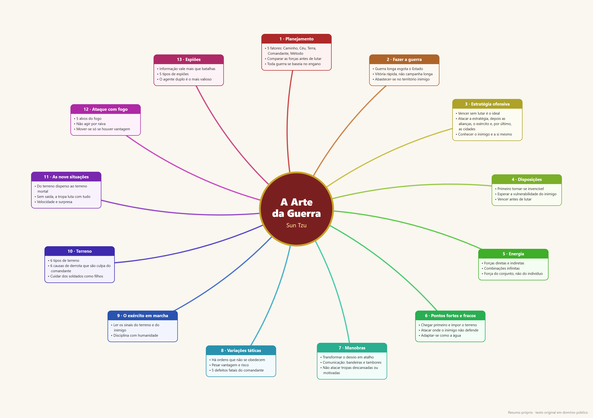

# Business Strategy — The Art of War

[Português](README.md) · **English** · [Español](README.es.md)

A skill for [Claude Code](https://claude.com/claude-code) that applies the principles of *The Art of War* (Sun Tzu) to real business situations: negotiation, competition, contract disputes, public tenders, sales, conflicts with suppliers or partners, and market entry.



> The mind map images are labeled in Portuguese. The same content, in English, is in [`skills/art-of-war/references/mind-map.md`](skills/art-of-war/references/mind-map.md) (Mermaid).

Vertical phone version: [`assets/mapa_mental_arte_da_guerra_celular.png`](assets/mapa_mental_arte_da_guerra_celular.png) (1080 px wide).
For printing: [`assets/mapa_mental_arte_da_guerra_A3.pdf`](assets/mapa_mental_arte_da_guerra_A3.pdf) (A3 landscape, vector — print at actual size).

## What the skill does

| Request | Result |
|---|---|
| "Art of War mind map" | Map of the 13 chapters (Mermaid) |
| "explain chapter 6" | Core ideas + 2 business applications |
| "strategy to renegotiate with supplier X" | Strategic analysis in 5 steps |
| "analyze the dispute between A and B" / election | **Observer mode**: the 5 steps applied to both sides, symmetrically and without taking sides |

### 5-step analysis

1. **5 factors** (ch. 1) — the Way, Heaven, Earth, the Commander and Method, comparing both sides
2. **Know the enemy and yourself** (ch. 3 and 13) — what is known and what is still missing
3. **Win without fighting** (ch. 3) — agreement before confrontation; litigation as a last resort
4. **Position and maneuver** (ch. 4–8) — protect yourself first, then exploit the other side's weakness
5. **Plan** — 3 to 5 actions with source chapter, deadline and risk

In business, "deception" means not revealing your own position — never lying or acting illegally.

## Installation

Copy the skill folder into Claude Code's skills directory:

```bash
git clone https://github.com/cesarsgobero-prog/estrategia-negocio-arte-da-guerra.git
cp -r estrategia-negocio-arte-da-guerra/skills/art-of-war ~/.claude/skills/
```

On Windows (PowerShell):

```powershell
git clone https://github.com/cesarsgobero-prog/estrategia-negocio-arte-da-guerra.git
Copy-Item -Recurse estrategia-negocio-arte-da-guerra\skills\art-of-war "$env:USERPROFILE\.claude\skills\"
```

Then, in Claude Code: `/art-of-war` or ask "what would Sun Tzu do in this negotiation?".

Install only one language version — they trigger on the same kind of request.

## Structure

```
skills/
  arte-da-guerra/             # Portuguese
  art-of-war/                 # English
    SKILL.md                  # skill instructions
    references/mind-map.md    # map of the 13 chapters + business translation
  arte-de-la-guerra/          # Spanish
assets/                       # mind map in PNG and SVG (landscape and phone) + A3 PDF
scripts/gerar_mapa.py         # generates the SVG/PNG (Python + headless Chrome)
```

To regenerate the image: `python scripts/gerar_mapa.py` (requires Google Chrome; adjust the `CHROME` path if needed).

## Source

*The Art of War* is in the public domain (English translation by Lionel Giles, 1910 — [Project Gutenberg](https://www.gutenberg.org/ebooks/132)). The texts in this repository are original summaries, not transcriptions.

## License

MIT — see [LICENSE](LICENSE).
