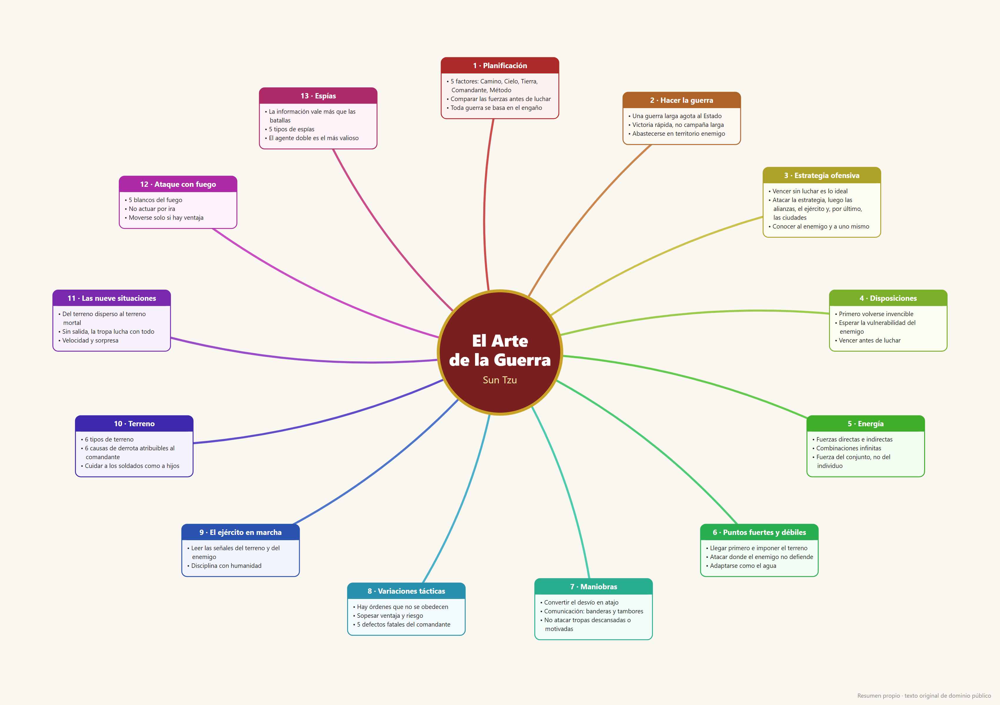

# Estrategia de Negocio — El Arte de la Guerra

[Português](README.md) · [English](README.en.md) · **Español**

Skill para [Claude Code](https://claude.com/claude-code) que aplica los principios de *El Arte de la Guerra* (Sun Tzu) a situaciones reales de negocio: negociación, competencia, disputas contractuales, licitaciones, ventas, conflictos con proveedores o socios y entrada en mercados.



Versión vertical para celular: [`assets/mapa_mental_arte_de_la_guerra_celular.png`](assets/mapa_mental_arte_de_la_guerra_celular.png) (1080 px de ancho).
Para imprimir: [`assets/mapa_mental_arte_de_la_guerra_A3.pdf`](assets/mapa_mental_arte_de_la_guerra_A3.pdf) (A3 horizontal, vectorial — imprimir a tamaño real).

## Qué hace la skill

| Pedido | Resultado |
|---|---|
| "mapa mental de el arte de la guerra" | Mapa de los 13 capítulos (Mermaid) |
| "explica el capítulo 6" | Ideas centrales + 2 aplicaciones en negocios |
| "estrategia para renegociar con el proveedor X" | Análisis estratégico en 5 pasos |
| "analiza la disputa entre A y B" / elección | **Modo observador**: los 5 pasos aplicados a ambos lados, de forma simétrica y sin tomar partido |

### Análisis en 5 pasos

1. **5 factores** (cap. 1) — el Camino, el Cielo, la Tierra, el Comandante y el Método, comparando ambos lados
2. **Conocer al enemigo y a uno mismo** (cap. 3 y 13) — lo que se sabe y lo que falta saber
3. **Vencer sin luchar** (cap. 3) — acuerdo antes que confrontación; litigio como último recurso
4. **Posición y maniobra** (cap. 4–8) — protegerse primero, luego aprovechar la debilidad del otro lado
5. **Plan** — 3 a 5 acciones con capítulo de origen, plazo y riesgo

En negocios, "engaño" significa no revelar la propia posición — nunca mentir ni actuar ilegalmente.

## Instalación

Copie la carpeta de la skill al directorio de skills de Claude Code:

```bash
git clone https://github.com/cesarsgobero-prog/estrategia-negocio-arte-da-guerra.git
cp -r estrategia-negocio-arte-da-guerra/skills/arte-de-la-guerra ~/.claude/skills/
```

En Windows (PowerShell):

```powershell
git clone https://github.com/cesarsgobero-prog/estrategia-negocio-arte-da-guerra.git
Copy-Item -Recurse estrategia-negocio-arte-da-guerra\skills\arte-de-la-guerra "$env:USERPROFILE\.claude\skills\"
```

Después, en Claude Code: `/arte-de-la-guerra` o pida "¿qué haría Sun Tzu en esta negociación?".

Instale solo una versión de idioma — todas se activan con el mismo tipo de pedido.

## Estructura

```
skills/
  arte-da-guerra/             # portugués
  art-of-war/                 # inglés
  arte-de-la-guerra/          # español
    SKILL.md                  # instrucciones de la skill
    references/mapa-mental.md # mapa de los 13 capítulos + traducción a negocios
assets/                       # mapa mental en PNG y SVG (horizontal y celular) + PDF A3, en pt/en/es
scripts/gerar_mapa.py         # genera el SVG/PNG/PDF (Python + Chrome headless)
```

Para regenerar las imágenes: `python scripts/gerar_mapa.py es` (o `pt`, `en`; sin argumento = todos). Requiere Google Chrome; ajuste la ruta en `CHROME` si es necesario.

## Fuente

*El Arte de la Guerra* está en dominio público (traducción inglesa de Lionel Giles, 1910 — [Project Gutenberg](https://www.gutenberg.org/ebooks/132)). Los textos de este repositorio son resúmenes propios, no transcripciones.

## Licencia

MIT — vea [LICENSE](LICENSE).
