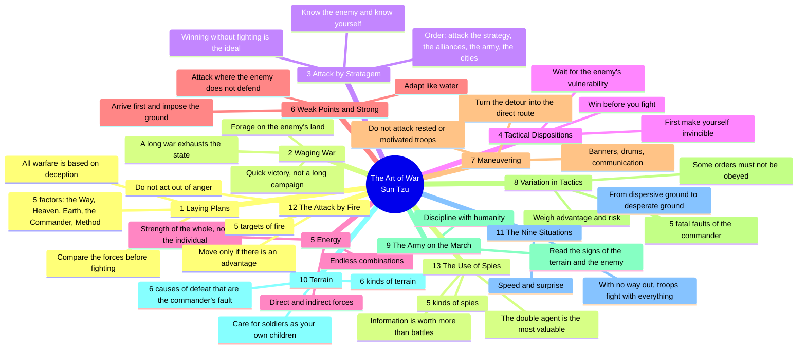

# Mind map — The Art of War (Sun Tzu)

To view: paste the block into mermaid.live or Obsidian.

## Business translation

| Chapter | Principle | In business |
|---|---|---|
| 1 | 5 factors | Diagnose before acting (morale, timing, market, leadership, structure) |
| 2 | A long war exhausts | Litigation and price wars burn cash; set a limit |
| 3 | Win without fighting | Agreement, partnership, or making the confrontation unnecessary |
| 4 | Invincible first | Guarantees, clauses, cash, an alternative (BATNA) before attacking |
| 5 | Direct and indirect | Main offer + side concessions/options |
| 6 | Strike the void | Niche, underserved customer, competitor's weak spot |
| 7 | Detour becomes shortcut | The longer route sometimes arrives first (e.g., partnership instead of direct entry) |
| 8 | 5 faults of the leader | Recklessness, cowardice, hot temper, pride, attachment — risks of whoever decides |
| 9 | Read the signs | The other side's behavior reveals the real situation |
| 10 | Terrain | Contractual position, jurisdiction, mutual dependence |
| 11 | Desperate ground | A team with no way out commits fully; use with care |
| 12 | Do not act out of anger | Emotional decisions destroy value |
| 13 | Information | Market intelligence is worth more than reaction |

Source: public domain text (trans. Lionel Giles, 1910 — Project Gutenberg). Original summary, not a transcription.
