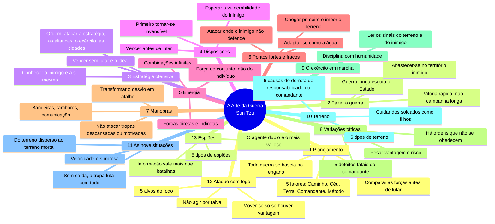

# Mapa mental — A Arte da Guerra (Sun Tzu)

Visualizar: colar o bloco em mermaid.live ou no Obsidian.

## Tradução para negócios

| Capítulo | Princípio | Em negócios |
|---|---|---|
| 1 | 5 fatores | Diagnóstico antes de agir (moral, momento, mercado, liderança, estrutura) |
| 2 | Guerra longa esgota | Litígio e guerra de preços consomem caixa; defina limite |
| 3 | Vencer sem lutar | Acordo, parceria ou tornar o confronto desnecessário |
| 4 | Invencível primeiro | Garantias, cláusulas, caixa, alternativa (BATNA) antes de atacar |
| 5 | Direto e indireto | Oferta principal + concessões/opções laterais |
| 6 | Atacar o vazio | Nicho, cliente mal atendido, ponto fraco do concorrente |
| 7 | Desvio vira atalho | Caminho mais longo às vezes chega antes (ex.: parceria em vez de entrada direta) |
| 8 | 5 defeitos do líder | Imprudência, covardia, irritação, orgulho, apego — riscos de quem decide |
| 9 | Ler sinais | Comportamento do outro lado revela a situação real |
| 10 | Terreno | Posição contratual, jurisdição, dependência mútua |
| 11 | Terreno mortal | Equipe sem saída se compromete; use com cuidado |
| 12 | Não agir por raiva | Decisão emocional destrói valor |
| 13 | Informação | Inteligência de mercado vale mais que reação |

Fonte: texto em domínio público (trad. Lionel Giles, 1910 — Project Gutenberg). Resumo próprio, não transcrição.
