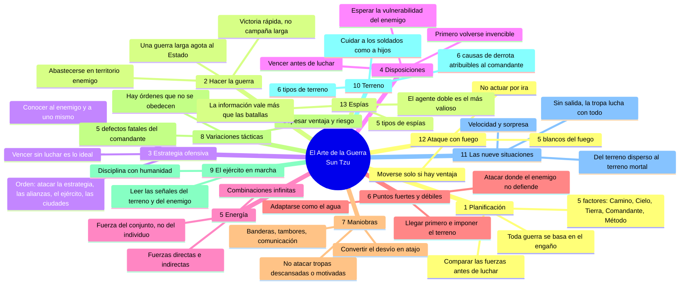

# Mapa mental — El Arte de la Guerra (Sun Tzu)

Para visualizar: pegue el bloque en mermaid.live o en Obsidian.

## Traducción a negocios

| Capítulo | Principio | En negocios |
|---|---|---|
| 1 | 5 factores | Diagnóstico antes de actuar (moral, momento, mercado, liderazgo, estructura) |
| 2 | La guerra larga agota | El litigio y la guerra de precios consumen caja; defina un límite |
| 3 | Vencer sin luchar | Acuerdo, alianza o volver innecesaria la confrontación |
| 4 | Invencible primero | Garantías, cláusulas, caja, alternativa (BATNA) antes de atacar |
| 5 | Directo e indirecto | Oferta principal + concesiones/opciones laterales |
| 6 | Atacar el vacío | Nicho, cliente mal atendido, punto débil del competidor |
| 7 | El desvío se vuelve atajo | El camino más largo a veces llega antes (p. ej., alianza en lugar de entrada directa) |
| 8 | 5 defectos del líder | Imprudencia, cobardía, irritación, orgullo, apego — riesgos de quien decide |
| 9 | Leer señales | El comportamiento del otro lado revela la situación real |
| 10 | Terreno | Posición contractual, jurisdicción, dependencia mutua |
| 11 | Terreno mortal | Un equipo sin salida se compromete; úselo con cuidado |
| 12 | No actuar por ira | La decisión emocional destruye valor |
| 13 | Información | La inteligencia de mercado vale más que la reacción |

Fuente: texto de dominio público (trad. Lionel Giles, 1910 — Project Gutenberg). Resumen propio, no transcripción.
